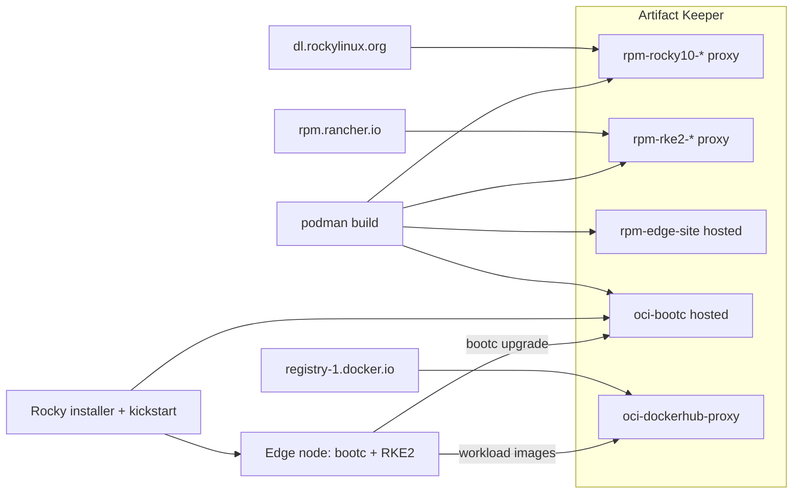
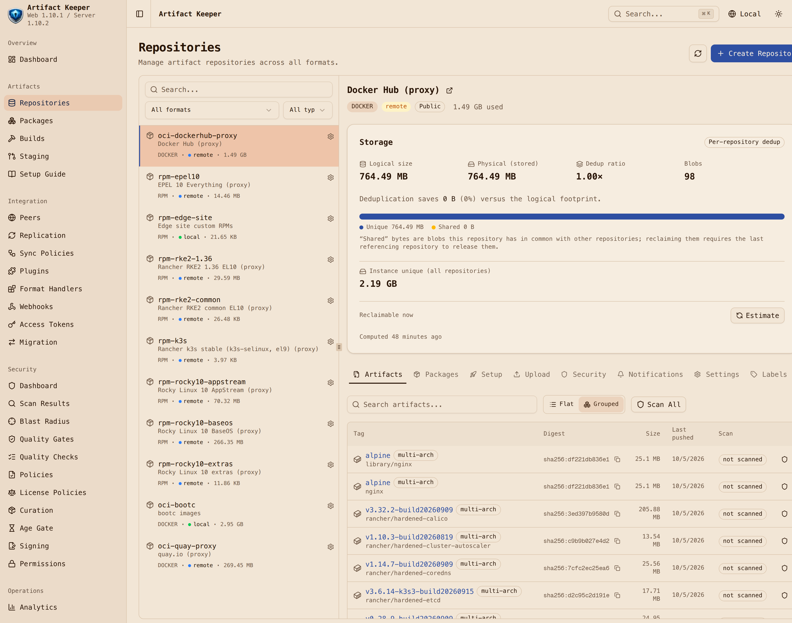
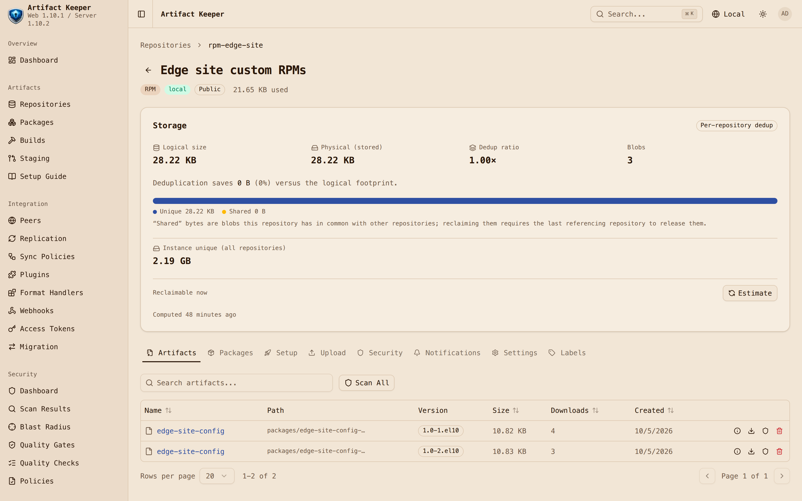
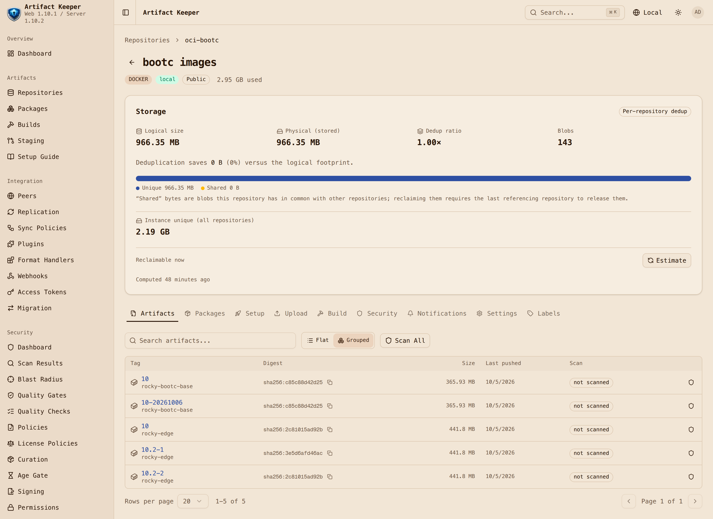
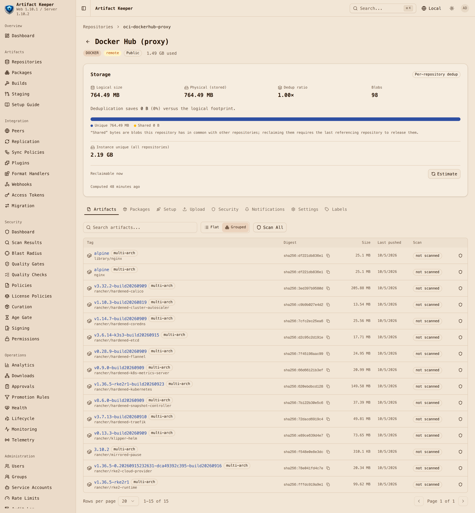

Edge fleets have a boring, expensive problem: every box in the field should be running the *same* operating system, the same Kubernetes, and the same site configuration, and you should be able to prove it. Traditional package-based installs drift the moment someone runs `dnf update` on one node and not another. Image mode fixes that at the OS layer: the whole system is a container image, nodes boot it, and upgrading means pointing them at a new image.

But an image is only as trustworthy as the place it came from. If the base RPMs come from a public mirror, the Kubernetes packages from a vendor repo, your own config from a tarball on someone's laptop, and the final image from yet another registry, you have four sources of truth and no single place to answer "what exactly is running on node 37?"

This post walks through a proof of concept that collapses all of that into one place. [Artifact Keeper](https://github.com/artifact-keeper/artifact-keeper), an open-source universal artifact registry, holds every byte a node boots from:

- Rocky Linux 10 BaseOS, AppStream, extras and EPEL, as **RPM proxy repositories**
- RKE2 (Kubernetes) packages, as another **RPM proxy**
- our own `edge-site-config` package, in a **hosted RPM repository**
- the Rocky bootc base image we build ourselves, and the final edge image layered on top of it, in a **hosted OCI registry**
- the container images the cluster runs, through **OCI pull-through proxies** for Docker Hub and quay.io

A bare-metal node boots the stock Rocky installer with a kickstart file, pulls the edge image from Artifact Keeper, and comes up running RKE2. Day-2 is a `bootc upgrade` against the same registry. Everything here is reproducible from [**github.com/brandonrc/rocky-custom-baremetal-deployment**](https://github.com/brandonrc/rocky-custom-baremetal-deployment); the "bare metal" in our run is a QEMU virtual machine, and the scripts use KVM when it is available and fall back to software emulation when it is not.



## Step 1: Artifact Keeper, and what the docs get wrong

Artifact Keeper ships a `docker-compose.yml` that brings up Postgres, OpenSearch, the Rust backend, the Next.js UI, and a Caddy front door on port 30080. We ran it under rootless podman with `podman compose` (which delegates to docker-compose). It came up in about a minute from cold. Three things bit us that the quickstart does not mention:

1. **The compose defaults are fatal.** `JWT_SECRET=change-me-in-production-please` is on a placeholder denylist in the backend and is rejected outright, and the `AK_WEBHOOK_SECRET_KEY` placeholder makes the backend `exit(1)`. You must generate both before first start. Our `up.sh` does `openssl rand -base64 48` and `-base64 32` and also sets `ADMIN_PASSWORD`, which skips the first-boot setup lock.
2. **Repositories are private by default.** Anonymous `dnf` or `podman pull` gets a 404 that hides the repo's existence. The field is `is_public: true` on create.
3. **The OCI registry is path-based.** Images live at `host:30080/<repo-key>/<image>:<tag>`; the first path segment selects the repository. The Docker guide's `localhost:8080/myapp` example only works if you happen to have a repo named `myapp`, and 8080 is not even published by the compose file.

With that out of the way, bootstrapping is a handful of `POST /api/v1/repositories` calls. The remote RPM repositories need a concrete `baseurl` (no mirrorlists), and the server generates `repodata` for hosted repos itself in Rust, with no `createrepo` involved:

```bash
curl -X POST http://localhost:30080/api/v1/repositories \
  -H "Authorization: Bearer $TOKEN" -H 'Content-Type: application/json' \
  -d '{"key":"rpm-rocky10-baseos","name":"Rocky 10 BaseOS","format":"rpm",
       "repo_type":"remote","is_public":true,
       "upstream_url":"https://dl.rockylinux.org/pub/rocky/10/BaseOS/x86_64/os/"}'

curl -X POST http://localhost:30080/api/v1/repositories \
  -H "Authorization: Bearer $TOKEN" -H 'Content-Type: application/json' \
  -d '{"key":"oci-bootc","name":"bootc images","format":"docker",
       "repo_type":"local","is_public":true}'
```

The resulting dnf configuration is the only one the image build will ever see:

```ini
[rpm-rocky10-baseos]
name=Rocky 10 BaseOS (via Artifact Keeper)
baseurl=http://host.containers.internal:30080/rpm/rpm-rocky10-baseos
enabled=1
gpgcheck=0
```

Uploading our own RPM is a single `PUT`, and `dnf` sees it in the generated metadata a moment later:

```bash
curl -u "admin:$TOKEN" --upload-file edge-site-config-1.0-1.el10.noarch.rpm \
  http://localhost:30080/rpm/rpm-edge-site/packages/edge-site-config-1.0-1.el10.noarch.rpm
```

The full set after bootstrapping, all created with `is_public: true` so edge nodes need no credentials to read:

| Key | Format | Type | Upstream |
|---|---|---|---|
| `rpm-rocky10-baseos`, `-appstream`, `-extras` | RPM | remote proxy | dl.rockylinux.org, Rocky 10 |
| `rpm-epel10` | RPM | remote proxy | dl.fedoraproject.org, EPEL 10 |
| `rpm-rke2-common`, `rpm-rke2-1.36` | RPM | remote proxy | rpm.rancher.io, RKE2 EL10 packages |
| `rpm-edge-site` | RPM | hosted | our `edge-site-config` package |
| `oci-bootc` | OCI | hosted | base and edge bootc images |
| `oci-quay-proxy`, `oci-dockerhub-proxy` | OCI | remote proxy | quay.io, registry-1.docker.io |

The whole bootstrap is one idempotent shell script in the repo, and it also mints a scoped API token for CI pushes so nothing in the pipeline uses the admin password.



## Step 2: Building the base when the distro has no official bootc image

Here is the first surprise. As of October 2026, **Rocky Linux publishes no official bootc base image.** `quay.io/rockylinux/rockylinux` has no `-bootc` tags, there is no image-mode page on docs.rockylinux.org, and the 10.2 release notes only mention that Cockpit's Image Builder can now emit bootable container images. CIQ sells bootc images for its Rocky Linux from CIQ product behind a subscription, and a community member rebuilds an unofficial one daily. What does exist is the recipe: the RESF SIG/Containers repository [`rocky-bootc`](https://git.resf.org/sig_containers/rocky-bootc), branch `r10`, which wraps the Fedora `bootc-base-images` tooling.

So we build the base ourselves. This turns out to be a feature, not a workaround, because now the base image's RPMs come through Artifact Keeper too.

The recipe is a two-stage Containerfile. A `rockylinux:10` builder installs `rpm-ostree`, runs `bootc-base-imagectl build-rootfs` from the treefile manifests, and exports a chunked OCI archive into a bind-mounted directory; the second stage is `FROM oci-archive:./out.ociarchive`. It needs `--cap-add=all --device /dev/fuse --security-opt=label=disable` because rpm-ostree composes a root filesystem inside the build. We expected that to require rootful podman. It did not: the recipe built unmodified under rootless podman 5.8 in under five minutes.

We changed three things, all in our own wrapper Containerfile, with the vendored upstream recipe untouched:

```dockerfile
#| highlight: 1, 4-6, 10
ARG BUILDER_IMAGE=localhost:30080/oci-quay-proxy/rockylinux/rockylinux:10
FROM ${BUILDER_IMAGE} as builder
COPY ak-rocky.repo /tmp/ak-rocky.repo
RUN rm -f /etc/yum.repos.d/*.repo \
 && install -m 0644 /tmp/ak-rocky.repo /etc/yum.repos.d/ak-rocky.repo \
 && dnf -y install rpm-ostree selinux-policy-targeted \
 && dnf clean all
COPY . /src
WORKDIR /src
ARG MANIFEST=minimal
RUN --mount=type=cache,target=/workdir /src/build.sh

FROM oci-archive:./out.ociarchive
# ... upstream's post-processing and labels, unchanged
```

1. **The builder image comes from the Artifact Keeper quay.io proxy** rather than Docker Hub.
2. **The builder's dnf repos are replaced with the Artifact Keeper Rocky proxies** before anything is installed. There is no repo setting anywhere in the recipe's manifests: `rpm-ostree compose rootfs --source-root=/` simply reuses the builder's `/etc/yum.repos.d`. Replace those files and every one of the 242 RPMs in the base comes through the registry. The build log confirms it: every package resolves from `rpm-rocky10-baseos` or `rpm-rocky10-appstream`.
3. **`MANIFEST=minimal` instead of the upstream default `standard`.** `standard` is 450 packages including sssd, nfs-utils and cloud agents, and its `autoupdates.yaml` links `bootc-fetch-apply-updates.timer` into `default.target.wants` under `/usr`. That means automatic fetch, apply, and reboot, and `systemctl is-enabled` reports it as `disabled` because it is a static link rather than an enablement. For a fleet whose upgrades are driven by retagging in the registry, surprise reboots are exactly wrong.

Two gotchas worth knowing if you try this. The `oci-archive:./out.ociarchive` path is resolved relative to podman's working directory, not the build context, so build from inside the context directory. And the final stage deletes its own input archive to keep your checkout clean, which means a second build with a warm cache fails on a missing file. Always pass `--no-cache` for this one.

The result is Rocky Linux 10.2 with kernel 6.12 and bootc 1.16.4, 68 chunked layers, 383 MB compressed, and a clean `bootc container lint`. It is byte-for-byte the same shape as the community image, which is reassuring. We push it as `oci-bootc/rocky-bootc-base:10` plus an immutable date tag.

## Step 3: Layering Kubernetes and site config, all from one registry

The edge image is a normal Containerfile `FROM` our base in Artifact Keeper. For Kubernetes we chose RKE2 over k3s for one practical reason: **RKE2 ships real EL10 RPMs** on `rpm.rancher.io`, both `rke2-server` and `rke2-selinux`, while k3s has no RPM at all and its SELinux policy for EL10 exists only as a testing build. RPMs mean the Kubernetes distribution flows through the same RPM proxy type as the OS, which is the whole point.

A detail that cost us a few minutes: Rancher's `rke2/stable/` RPM tree contains minors from 1.32 through 1.37, but the actual `stable` release channel was v1.36.5. The directory name is not the channel. We proxy `stable/1.36/centos/10/x86_64` and the common `noarch` tree.

```dockerfile
#| highlight: 12-13, 20-21, 28-30, 32
ARG BASE_IMAGE=localhost:30080/oci-bootc/rocky-bootc-base:10
FROM ${BASE_IMAGE}

COPY build.repo /tmp/build-repos/build.repo
COPY edge.repo /tmp/edge.repo

# Layer 1: OS additions + RKE2. Unchanged across site-config releases.
RUN set -eux; \
    rm -f /etc/yum.repos.d/*.repo; \
    install -m 0644 /tmp/edge.repo /etc/yum.repos.d/edge.repo; \
    kver="$(rpm -q --qf '%{VERSION}-%{RELEASE}' kernel)"; \
    dnf -y --setopt=reposdir=/tmp/build-repos --setopt=install_weak_deps=False install \
        NetworkManager openssh-server bubblewrap "kernel-modules-extra-${kver}" rke2-server rke2-selinux; \
    systemctl enable NetworkManager.service sshd.service rke2-server.service; \
    rm -rf /run/k3s; rm -rf /opt && ln -s var/opt /opt; \
    dnf clean all; rm -rf /var/cache/dnf /var/lib/dnf /var/log/dnf*.log

# Layer 2: the site configuration RPM (the only thing that changes on day 2).
ARG SITE_RELEASE=1
RUN set -eux; \
    dnf -y --setopt=reposdir=/tmp/build-repos install "edge-site-config-1.0-${SITE_RELEASE}.el10"; \
    systemctl enable edge-site-manifests.service; \
    dnf clean all; rm -rf /tmp/build-repos /var/cache/dnf /var/lib/dnf /var/log/dnf*.log

COPY rootfs/ /   # kargs.d console settings, tmpfiles.d for /var/lib/rancher

# Fail the build if any dnf repo URL does not point at Artifact Keeper.
RUN set -eu; \
    bad="$(grep -rhE '^\s*(baseurl|mirrorlist|metalink)\s*=' /etc/yum.repos.d/ | grep -v ':30080/' || true)"; \
    [ -z "$bad" ] || { echo "non-Artifact-Keeper repo URL(s): $bad" >&2; exit 1; }

RUN bootc container lint --fatal-warnings
```

A few things in here are deliberate:

- **Two views of the same registry.** The build runs with `build.repo`, where the host is `host.containers.internal:30080`, but the image ships `edge.repo`, where the host is `10.0.2.2:30080`, the address a node sees. Same eight repositories, different hostname.
- **The repo check is a build gate.** The base image carries Rocky's stock `rocky*.repo` files with mirrorlist URLs. We delete them and then grep for any `baseurl`, `mirrorlist` or `metalink` that does not point at Artifact Keeper. If someone adds a stray upstream URL, the build fails.
- **`kernel-modules-extra` is pinned to the base kernel.** RKE2 needs it on EL10, and the proxy offers about twenty kernel builds; an unpinned install could pull a second kernel alongside.
- **bootc lint runs with `--fatal-warnings`.** The first build passed lint but warned twice, both because of the RKE2 packages: `rke2-common` ships `/var/run/k3s` (and `/var/run` is `/run`, which must be empty in a bootc image), and `/var/lib/rancher` had no tmpfiles.d entry. In image mode, `/var` is seeded once at install and then belongs to the machine, so package-owned `/var` directories need a tmpfiles.d declaration. Both fixed; lint is clean.
- **Layer order is a day-2 optimisation.** Our first version installed RKE2 and the site RPM in one `RUN`, so bumping the site config changed a 72 MB layer. Split into two, a site-config release now changes two layers totalling **7.7 MB** compressed. That is the download every edge node pays for a config change.

One more image-mode lesson, and this one only shows up on a booted node. The first install came up with RKE2 active and every pod Pending, because canal's `install-cni` container failed with `mkdir /opt/cni: read-only file system`. The RESF base deliberately keeps `/opt` on the read-only image (the Fedora bootc `minimal` manifest sets `opt-usrlocal: "root"`), and the recipe points `/usr/local` back at `/var/usrlocal` but leaves `/opt` alone. No RKE2 package ships anything under `/opt`; only the CNI installer writes there at runtime. Neither `podman run` nor `bootc container lint` can catch that, since nothing is read-only inside a container build. The fix is the classic ostree layout: replace `/opt` with a symlink to `var/opt` and declare `/var/opt/cni/bin` in tmpfiles.d. Then the image build asserts both symlinks in its smoke test so it cannot regress quietly.

The `edge-site-config` RPM itself is small and boring, which is how site configuration should be. It carries RKE2's `config.yaml` (single-node server, `selinux: true`), the RKE2 `registries.yaml`, a MOTD that includes the package release so you can see day-2 land, an insecure-registry drop-in so `bootc upgrade` can reach our plain-HTTP registry, a NetworkManager drop-in that keeps it off RKE2's canal interfaces, and a sample nginx Deployment plus a oneshot service that copies it into RKE2's auto-deploy manifests directory on every boot (it has to be every boot, because the manifests live under `/usr` and `/var` is not touched by upgrades).

The `registries.yaml` is where the last piece of the story clicks into place. Artifact Keeper serves its Docker Hub proxy under a path prefix, and containerd mirrors are host-level, so we use RKE2's `rewrite`:

```yaml
mirrors:
  docker.io:
    endpoint:
      - "http://10.0.2.2:30080"
    rewrite:
      "^(.*)$": "oci-dockerhub-proxy/$1"
```

Now `docker.io/library/nginx:alpine` becomes a request for `/v2/oci-dockerhub-proxy/library/nginx/manifests/alpine`. Because this mirrors all of `docker.io`, RKE2's own system images such as `rancher/rke2-runtime` come through the registry as well, and containerd falls back to the public endpoint if the mirror fails.

Building the RPM is `rpmbuild` in a `rockylinux:10` container (again pulled through the quay.io proxy, again with dnf pointed only at Artifact Keeper), about five seconds per release. Uploading is one `PUT` per file. One thing to know: re-uploading a file name that already exists returns **HTTP 409** and keeps the stored file, even if your local bytes differ. Treat NEVRAs as immutable and bump the release, which is good practice anyway.



Final numbers for the edge image: 75 layers, 463 MB compressed, 11 packages and 38 MB downloaded on top of the base. The edge build takes about 23 seconds cold and 8 seconds for a site-config bump, and pushes take one to four seconds because the 68 base layers are already in `oci-bootc`. We push `rocky-edge:10.2-1` and `rocky-edge:10.2-2` as immutable tags and point the floating `rocky-edge:10` at the first one with a registry-side `skopeo copy`. Promotion is moving that tag.



## Step 4: Kickstart onto bare metal

With the image in the registry, deploying a node is the oldest trick in the Enterprise Linux book: network-boot the stock installer and hand it a kickstart. No custom ISO, no disk image to copy around, no `bootc-image-builder` (which needs rootful podman anyway). Anaconda in Rocky 10.2 knows how to pull a bootc image and deploy it as the payload.

We boot the installer's own `vmlinuz` and `initrd.img` from the Rocky 10.2 mirror's `images/pxeboot/` directory, point `inst.stage2` at the mirror, and serve the kickstart over HTTP from the workstation. In a real rack that is a PXE server and a DHCP option; in our harness it is a QEMU command line and `python3 -m http.server`. The kickstart is the interesting part:

```text
#| highlight: 10-17, 19, 22
text
network --bootproto=dhcp --device=link --activate --hostname=edge-node-01

zerombr
clearpart --all --initlabel --disklabel=gpt
reqpart --add-boot
part / --grow --fstype=xfs

# The registry is plain HTTP (PoC). Anaconda honours registries.conf.
%pre
mkdir -p /etc/containers/registries.conf.d
cat > /etc/containers/registries.conf.d/50-poc-insecure.conf <<'EOR'
[[registry]]
location = "10.0.2.2:30080"
insecure = true
EOR
%end

ostreecontainer --url=10.0.2.2:30080/oci-bootc/rocky-edge:10 --transport=registry --no-signature-verification

rootpw --lock
sshkey --username=root "ssh-ed25519 AAAA..."
reboot
```

There is no `%packages` section. The image *is* the package list. The only per-node inputs are the hostname and the operator's SSH key, and the installer never asks anyone to type a password.

Two findings from this step:

**Use `ostreecontainer`, not the newer `bootc` kickstart command.** Rocky 10.2 ships anaconda 40.22 and pykickstart 3.52, and both commands validate. The `bootc` command runs `bootc install to-filesystem` under the hood and is the documented future. On Rocky 10.2 it produced a system where `/root/.ssh/authorized_keys` was labelled `var_t` and `/etc/resolv.conf` was `etc_t`; sshd could not read the key and NetworkManager could not write DNS, so the node was unreachable. A `restorecon` in `%post` did not help. The same image installed with `ostreecontainer`, which runs `ostree container image deploy`, came up correctly labelled with SELinux enforcing. We did not chase the root cause further; the point for a fleet is that you test the install path, not just the image.

**Mark the registry insecure in both places.** Anaconda pulls the image inside the installer environment, so the `registries.conf.d` drop-in has to exist there (`%pre`). The installed system needs the same drop-in for `bootc upgrade`, so the `edge-site-config` RPM bakes it into the image, and the kickstart writes it into the installed `/etc` as well. In production you would terminate TLS at Artifact Keeper's Caddy front door and distribute the CA instead; the mechanics are the same.

What happens on power-on, under software emulation with no KVM (so these numbers are pessimistic by roughly a factor of five):

| Milestone | Time from power-on |
|---|---|
| Installer running (kernel, initrd and stage2 fetched over HTTPS) | 315 s |
| Kickstart applied, storage configured | 375 s |
| Image pulled from Artifact Keeper and deployed (74 layers, 463 MB) | 570 s |
| Installer exits, machine reboots | 601 s |
| SSH answers on the installed system | 52 s |
| RKE2 node Ready | 324 s |
| Demo workload Running | about 400 s |

The verification script then runs over SSH, and this is the output that makes the whole exercise worthwhile:

```text
=== bootc status ===
spec:    image: 10.0.2.2:30080/oci-bootc/rocky-edge:10   transport: registry
booted:  version: 10.2-1   imageDigest: sha256:3e5d6afd46ac...
=== getenforce ===
Enforcing
=== kubectl get nodes -o wide ===
NAME           STATUS   ROLES                VERSION          OS-IMAGE                        KERNEL-VERSION
edge-node-01   Ready    control-plane,etcd   v1.36.5+rke2r1   Rocky Linux 10.2 (Red Quartz)   6.12.0-211.61.1.el10_2.x86_64
=== workload image / imageID ===
default/nginx-demo-...  docker.io/library/nginx:alpine  docker.io/library/nginx@sha256:df221db8...
=== Artifact Keeper: oci-dockerhub-proxy ===
98 cached objects; images: library/nginx, rancher/hardened-calico, rancher/hardened-coredns,
  rancher/hardened-etcd, rancher/hardened-kubernetes, rancher/klipper-helm, rancher/rke2-runtime, ...
OK: nginx-demo runs nginx:alpine @ sha256:df221db8..., and that manifest is cached in oci-dockerhub-proxy
```

Every image the cluster pulled, from `rancher/hardened-calico` to the demo's `nginx:alpine`, is now cached in `oci-dockerhub-proxy`, visible in the Artifact Keeper UI next to the RPMs and the OS image that produced the node. One place to look.



## Step 5: Day-2 is a tag move

Upgrading the fleet does not touch the nodes. We bump `edge-site-config` to release 2 (new MOTD, a new label on the demo Deployment), rebuild the edge image, push it as `rocky-edge:10.2-2`, and then **promote** by copying that tag onto the floating `rocky-edge:10` inside the registry. The copy is manifest-only and takes one second, because every blob is already in `oci-bootc`.

```bash
#| command-line
#| data-filter-output: (out)
skopeo copy docker://localhost:30080/oci-bootc/rocky-edge:10.2-2 \
            docker://localhost:30080/oci-bootc/rocky-edge:10
ssh -p 2222 root@localhost bootc upgrade
(out)layers already present: 73; layers needed: 3 (7.8 MB)
(out)Deploying...done (21 seconds)
(out)Queued for next boot: 10.0.2.2:30080/oci-bootc/rocky-edge:10
(out)  Version: 10.2-2
(out)  Digest: sha256:2c81015ad92b6c7b77fa19cbe74e9d62d661f725d7b6f6ac4cab58bf023e2726
```

The node downloads 7.8 MB, stages the new deployment, and reboots into it. After the reboot `bootc status` shows 10.2-2 booted with 10.2-1 as the rollback, the MOTD reads `edge-site-config 1.0-2.el10: day-2 update via bootc upgrade (release 2)`, and RKE2 has re-applied the re-seeded manifests, so the Deployment rolled to the release-2 label. `bootc rollback` plus a reboot puts everything back, manifests included, because the seeding service runs from whichever image is booted. We ran it both ways.

This step produced the most instructive failure of the project. On our second image revision the upgrade staged cleanly, the node rebooted, and came back on the **old** image with the staged deployment gone and no error in the current journal. The clue was in the next boot's `ostree-boot-complete` output:

```text
ostree-finalize-staged.service failed on previous boot: Finalizing deployment:
Finalizing SELinux policy: Failed to execute child process "/usr/bin/bwrap"
(No such file or directory)
```

At shutdown, ostree finalizes the staged deployment and, because `rke2-selinux` adds policy modules so `/etc/selinux` differs from the image's, it rebuilds the SELinux policy by running `semodule` inside bubblewrap. The RESF minimal base does not include `bubblewrap`, no package declares a dependency on it (libostree calls `/usr/bin/bwrap` by hard-coded path), and our base build never noticed because the builder container had it as a dependency of rpm-ostree. The community image ships it, apparently for exactly this reason. We proved the diagnosis on the live node by temporarily overlaying `/usr` with `bootc usr-overlay` and installing the package; the next upgrade went through. The fix is one more package in the Containerfile, plus a tmpfiles.d entry for `/var/log/journal` so the journal persists across boots and the next person does not have to find this in a serial log.

## What we learned

**The registry-as-source-of-truth idea holds up.** By the end, Artifact Keeper held the base OS packages, the Kubernetes packages, our site package, the base image, two edge image releases, and every container image the cluster pulled, and the node had never contacted anything else except the Rocky mirror for the installer itself. "What is running on node 37?" is now `bootc status` on the node and a digest lookup in one registry. Promotion is a tag copy, rollback is built in, and a site-config change costs each node 7.8 MB.

**Image mode's failure modes are different from package mode's.** Neither of our two real bugs was visible in `podman build`, `podman run`, or `bootc container lint`. A read-only `/opt` only matters once the root filesystem is actually read-only, and a missing finalize-time dependency only matters at the first upgrade. If you adopt image mode, your CI needs a stage that boots the image and upgrades it, not just builds it. Our QEMU harness is that stage.

**Rocky is early here.** No official base image, a kickstart `bootc` command that mislabels files on 10.2, a minimal manifest without `bubblewrap`. None of these are hard to work around, and the RESF recipe building rootless on the first try was a pleasant surprise. Expect this to settle quickly; check whether an official image exists before copying our `base/` directory.

**Artifact Keeper is young too, and honest about it.** The compose defaults refuse to start until you generate secrets, repos are private by default, and the docs lag the code in places (ports, upload paths, a `visibility` field that is really `is_public`). Once running, it did everything we asked, and the proxy types made the "one place" story possible without mirroring anything by hand.

What we would change for production: terminate TLS at Artifact Keeper and distribute the CA instead of marking the registry insecure; sign the images and drop `--no-signature-verification`; install nodes by digest and let them track the tag afterwards; serve the installer kernel and initrd from the registry too, so even the PXE media has one source; and block egress, since RKE2's generated `hosts.toml` keeps `registry-1.docker.io` as a fallback.

Timings for the curious, all under QEMU software emulation because this workstation had hardware virtualization disabled in firmware (with KVM, expect roughly a fifth of these):

| Stage | Time |
|---|---|
| Kickstart install, power-on to installer exit | 601 s |
| First boot to SSH | 52 s |
| SSH to Kubernetes node Ready | 272 s |
| Demo workload Running after Ready | 76 s |
| `bootc upgrade` pull and stage | 69 s |
| Reboot to SSH after upgrade or rollback | 148 s |
| Base image build (rootless) | 211 s |
| Edge image build, cold / site-config bump | 23 s / 8 s |

Everything, including the harness that produced these numbers, is in [github.com/brandonrc/rocky-custom-baremetal-deployment](https://github.com/brandonrc/rocky-custom-baremetal-deployment). `make all` builds and pushes the images; `make vm-install vm-boot vm-verify vm-upgrade vm-rollback` walks the node through its whole life.
