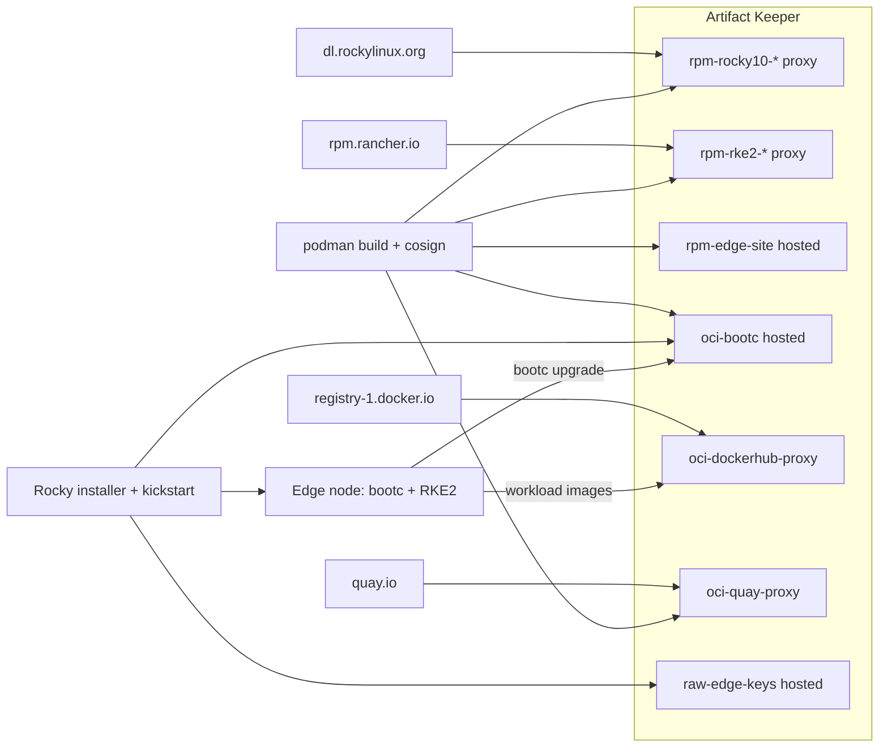

OpenTeams spends most of its days on AI and ML and the infrastructure that runs it. This post is about something less glamorous: the hardware in a rack in a closet, the box somebody has to drive to when it misbehaves. If that is your world, keep reading. If you know someone whose world it is, send this their way.

Two invitations before we start. If you run deployments that have grown complicated and you suspect a system like this could simplify them, I would like to hear about them; my contact is at the bottom, and we can work out where Artifact Keeper fits. And if you are a nerd like me who wants to try this in a home lab, I want to hear how that goes just as much.

## The problem: four sources of truth

Edge fleets have an expensive problem: every box in the field should be running the *same* operating system, the same Kubernetes, and the same site configuration, and you should be able to prove it. Package-based installs drift the moment someone runs `dnf update` on one node and not another. Image mode fixes that at the OS layer. With [bootc](https://bootc-dev.github.io/bootc/), the whole operating system ships as a container image: you build it with a Containerfile, nodes boot it, and upgrading means pointing them at a new image. Rocky Linux image mode is the same idea on Rocky.

But an image is only as trustworthy as the place it came from. If the base RPMs come from a public mirror, the Kubernetes packages from a vendor repository, your own config from a tarball on someone's laptop, and the final image from yet another registry, you have four sources of truth and no single place to answer "what exactly is running on node 37?"

This post walks through a proof of concept that collapses all of that into one place. [Artifact Keeper](https://github.com/artifact-keeper/artifact-keeper), an open-source universal artifact registry, holds every byte a node boots from:

- Rocky Linux 10 BaseOS, AppStream, extras and EPEL, as **RPM proxy repositories**
- RKE2 (Kubernetes) packages, as another **RPM proxy**
- our own `edge-site-config` package, in a **hosted RPM repository**
- the Rocky bootc base image we build ourselves, and the edge image layered on top of it, in a **hosted OCI registry**
- the container images the cluster runs, through **OCI proxies** for Docker Hub and quay.io
- the public keys everything is verified against, in a **hosted generic repository**

A node boots the stock Rocky installer with a kickstart file (the answer file the Enterprise Linux installer reads), pulls the edge image from Artifact Keeper, and comes up running RKE2. Upgrades are a `bootc upgrade` against the same registry, and every RPM and image is signed and verified on the way in. The code is in [github.com/brandonrc/rocky-custom-baremetal-deployment](https://github.com/brandonrc/rocky-custom-baremetal-deployment); the full reference, from [setting up the environment](https://brandonrc.github.io/rocky-custom-baremetal-deployment/environment/) to [every make target](https://brandonrc.github.io/rocky-custom-baremetal-deployment/walkthrough/), is on its [documentation site](https://brandonrc.github.io/rocky-custom-baremetal-deployment/). Our "bare metal" is a virtual machine; nothing in the pipeline knows the difference.



The [architecture page](https://brandonrc.github.io/rocky-custom-baremetal-deployment/architecture/) has the full version of this diagram and the complete repository list.

## Step 1: Stand up Artifact Keeper as the single registry

Artifact Keeper ships a `docker-compose.yml` that brings up Postgres, OpenSearch, the Rust backend, the Next.js UI, and a Caddy front door on port 30080. We ran it under rootless podman. It came up in about a minute from cold. Three things the quickstart does not mention:

1. **The compose defaults are fatal.** `JWT_SECRET=change-me-in-production-please` is on a placeholder denylist in the backend and is rejected outright, and the `AK_WEBHOOK_SECRET_KEY` placeholder makes the backend `exit(1)`. You must generate both before first start. Our `up.sh` does `openssl rand -base64 48` and `-base64 32` and also sets `ADMIN_PASSWORD`, which skips the first-boot setup lock.
2. **Repositories are private by default.** Anonymous `dnf` or `podman pull` gets a 404 until you create the repository with `is_public: true`.
3. **The OCI registry is path-based.** Images live at `host:30080/<repo-id>/<image>:<tag>`; the first path segment selects the repository. The guides' `localhost:8080/...` examples do not match the compose file, which publishes 30080 and never exposes 8080.

With that out of the way, bootstrapping is a handful of `POST /api/v1/repositories` calls. Remote RPM repositories need a concrete `baseurl` (no mirrorlists), and the server generates `repodata` for hosted repositories itself, with no `createrepo` involved:

```bash
curl -X POST http://localhost:30080/api/v1/repositories \
  -H "Authorization: Bearer $TOKEN" -H 'Content-Type: application/json' \
  -d '{"key":"rpm-rocky10-baseos","name":"Rocky 10 BaseOS","format":"rpm",
       "repo_type":"remote","is_public":true,
       "upstream_url":"https://dl.rockylinux.org/pub/rocky/10/BaseOS/x86_64/os/"}'

curl -X POST http://localhost:30080/api/v1/repositories \
  -H "Authorization: Bearer $TOKEN" -H 'Content-Type: application/json' \
  -d '{"key":"oci-bootc","name":"bootc images","format":"docker",
       "repo_type":"local","is_public":true}'
```

The resulting dnf configuration is the only one the image build will ever see:

```ini
[rpm-rocky10-baseos]
name=Rocky Linux 10 BaseOS (proxy)
baseurl=http://host.containers.internal:30080/rpm/rpm-rocky10-baseos
enabled=1
gpgcheck=1
gpgkey=file:///etc/pki/rpm-gpg/RPM-GPG-KEY-Rocky-10
```

Uploading our own RPM is a single `PUT`, and `dnf` sees it in the generated metadata a moment later:

```bash
curl -u "admin:$TOKEN" --upload-file edge-site-config-1.0-3.el10.noarch.rpm \
  http://localhost:30080/rpm/rpm-edge-site/packages/edge-site-config-1.0-3.el10.noarch.rpm
```

The full set after bootstrapping, all created with `is_public: true` so edge nodes need no credentials to read:

| Repository | Format | Type | Upstream or contents |
|---|---|---|---|
| `rpm-rocky10-baseos`, `-appstream`, `-extras` | RPM | proxy | dl.rockylinux.org, Rocky 10 |
| `rpm-epel10` | RPM | proxy | dl.fedoraproject.org, EPEL 10 |
| `rpm-rke2-common`, `rpm-rke2-1.36` | RPM | proxy | rpm.rancher.io, RKE2 EL10 packages |
| `rpm-k3s` | RPM | proxy | rpm.rancher.io, k3s SELinux policy only; kept for a k3s fallback |
| `rpm-edge-site` | RPM | hosted | our `edge-site-config` package |
| `oci-bootc` | OCI | hosted | base and edge bootc images, and their signatures |
| `oci-quay-proxy`, `oci-dockerhub-proxy` | OCI | proxy | quay.io, registry-1.docker.io |
| `raw-edge-keys` | generic | hosted | public keys (added in Step 6) |

The whole bootstrap is one idempotent shell script in the repo. It also mints a scoped API token, so routine pushes and uploads never use the admin password. Everything else we learned about Artifact Keeper along the way, including the API calls that worked and the places the docs lag the code, is in the [Artifact Keeper notes](https://brandonrc.github.io/rocky-custom-baremetal-deployment/artifact-keeper-notes/).


## Step 2: Build a Rocky Linux image mode base yourself

Here is the first surprise. As of October 2026, **Rocky Linux publishes no official bootc base image.** CIQ, the commercial Rocky vendor, sells one behind a subscription, and a community member rebuilds an unofficial one daily. What does exist is the recipe: the Rocky Enterprise Software Foundation's [`rocky-bootc`](https://git.resf.org/sig_containers/rocky-bootc) repository, branch `r10`, which wraps the Fedora `bootc-base-images` tooling.

So we build the base ourselves. This turns out to be a feature, not a workaround, because now the base image's RPMs come through Artifact Keeper too.

The recipe is a two-stage Containerfile. A `rockylinux:10` builder installs `rpm-ostree` (ostree is the content store bootc uses to keep the OS read-only and versioned), composes a root filesystem from the recipe's manifests, and exports it as a chunked OCI archive into a bind-mounted directory. The second stage is `FROM oci-archive:./out.ociarchive`. The build needs `--cap-add=all --device /dev/fuse --security-opt=label=disable -v $(pwd):/buildcontext`, and it built unmodified under rootless podman in under five minutes, which matters if you want this in a CI runner.

We changed three things, all in our own wrapper Containerfile, with the vendored upstream recipe untouched:

```dockerfile
#| highlight: 1, 4-6, 10
ARG BUILDER_IMAGE=localhost:30080/oci-quay-proxy/rockylinux/rockylinux:10
FROM ${BUILDER_IMAGE} as builder
COPY ak-rocky.repo /tmp/ak-rocky.repo
RUN rm -f /etc/yum.repos.d/*.repo \
 && install -m 0644 /tmp/ak-rocky.repo /etc/yum.repos.d/ak-rocky.repo \
 && dnf -y install rpm-ostree selinux-policy-targeted \
 && dnf clean all
COPY . /src
WORKDIR /src
ARG MANIFEST=minimal
RUN --mount=type=cache,target=/workdir /src/build.sh

FROM oci-archive:./out.ociarchive
# ... upstream's post-processing and labels, unchanged
```

1. **The builder image comes from the Artifact Keeper quay.io proxy** rather than Docker Hub.
2. **The builder's dnf repositories are replaced with the Artifact Keeper Rocky proxies** before anything is installed. There is no repository setting anywhere in the recipe's manifests: `rpm-ostree compose rootfs --source-root=/` simply reuses the builder's `/etc/yum.repos.d`. Replace those files and every one of the 242 RPMs in the base comes through the registry. The build log confirms it: every package resolves from `rpm-rocky10-baseos` or `rpm-rocky10-appstream`.
3. **`MANIFEST=minimal` instead of the upstream default `standard`.** `standard` is 450 packages including sssd, nfs-utils and cloud agents, and its `autoupdates.yaml` links `bootc-fetch-apply-updates.timer` into `default.target.wants` under `/usr`. That means automatic fetch, apply, and reboot, and `systemctl is-enabled` reports it as `disabled` because it is a static link rather than an enablement. For a fleet whose upgrades are driven by retagging in the registry, surprise reboots are exactly wrong.

The result is Rocky Linux 10.2 with kernel 6.12 and bootc 1.16.4, 68 chunked layers, 383 MB compressed, and a clean `bootc container lint`. It is essentially the same shape as the community image (242 RPMs and 68 layers against 238 and 65), which is reassuring. We push it as `oci-bootc/rocky-bootc-base:10` plus an immutable date tag. The two build-system gotchas we hit, about working directories and `--no-cache`, are in the [image build notes](https://brandonrc.github.io/rocky-custom-baremetal-deployment/findings-image/).

## Step 3: Layer RKE2 and site config from the same registry

The edge image is a normal Containerfile `FROM` our base in Artifact Keeper. For Kubernetes we chose RKE2 over k3s for one practical reason: **RKE2 ships real EL10 RPMs** on `rpm.rancher.io`, both `rke2-server` and `rke2-selinux`, while k3s has no RPM at all. RPMs mean the Kubernetes distribution flows through the same RPM proxy type as the OS, which is the whole point. We proxy the `stable/1.36` tree, the version the RKE2 stable channel pointed at.

Tags follow one rule: `rocky-edge:<Rocky minor>-<site-config release>`, so `10.2-4` is Rocky 10.2 plus `edge-site-config` release 4. We build two releases of the site config so day-2 has something to ship. The ones you will see in this post are 3 and 4; releases 1 and 2 were an unsigned dry run, and Step 6 explains why they stay in the registry.

```dockerfile
#| highlight: 12-13, 16, 20-22, 30-32, 34
ARG BASE_IMAGE=localhost:30080/oci-bootc/rocky-bootc-base:10
FROM ${BASE_IMAGE}

COPY build.repo /tmp/build-repos/build.repo
COPY edge.repo /tmp/edge.repo

# Layer 1: OS additions + RKE2. Unchanged across site-config releases.
RUN set -eux; \
    rm -f /etc/yum.repos.d/*.repo; \
    install -m 0644 /tmp/edge.repo /etc/yum.repos.d/edge.repo; \
    kver="$(rpm -q --qf '%{VERSION}-%{RELEASE}' kernel)"; \
    dnf -y --setopt=reposdir=/tmp/build-repos --setopt=install_weak_deps=False install \
        NetworkManager openssh-server bubblewrap "kernel-modules-extra-${kver}" rke2-server rke2-selinux; \
    systemctl enable NetworkManager.service sshd.service rke2-server.service; \
    rm -rf /run/k3s; \
    rm -rf /opt && ln -s var/opt /opt; \
    dnf clean all; rm -rf /var/cache/dnf /var/lib/dnf /var/log/dnf*.log

# Layer 2: the site configuration RPM (the only thing that changes on day 2).
ARG SITE_RELEASE=3
RUN set -eux; \
    dnf -y --setopt=reposdir=/tmp/build-repos install "edge-site-config-1.0-${SITE_RELEASE}.el10"; \
    systemctl enable edge-site-manifests.service; \
    dnf clean all; rm -rf /tmp/build-repos /var/cache/dnf /var/lib/dnf /var/log/dnf*.log

# Kernel arguments, tmpfiles.d entries, and (from Step 6) the signature policy and key.
COPY rootfs/ /

# Fail the build if any dnf repository URL does not point at Artifact Keeper.
RUN set -eu; \
    bad="$(grep -rhE '^\s*(baseurl|mirrorlist|metalink)\s*=' /etc/yum.repos.d/ | grep -v ':30080/' || true)"; \
    [ -z "$bad" ] || { echo "non-Artifact-Keeper repo URL(s): $bad" >&2; exit 1; }

RUN bootc container lint --fatal-warnings
```

Three things in here are deliberate:

- **Two views of the same registry.** The build runs with `build.repo`, where the host is `host.containers.internal:30080`, but the image ships `edge.repo`, where the host is `10.0.2.2:30080`, the address a node sees on our test network. Same repositories, different hostname. The [architecture page](https://brandonrc.github.io/rocky-custom-baremetal-deployment/architecture/#two-views-of-the-same-registry) explains why that matters once signatures enter the picture.
- **The repository check is a build gate.** The base image carries Rocky's stock `rocky*.repo` files with mirrorlist URLs. We delete them and then grep for any `baseurl`, `mirrorlist` or `metalink` that does not point at Artifact Keeper. If someone adds a stray upstream URL, the build fails.
- **Layer order is a day-2 optimization.** Our first version installed RKE2 and the site RPM in one `RUN`, so bumping the site config changed a 72 MB layer. Split into two, a site-config release changes three small layers totalling about 8 MB. That is the download every edge node pays for a config change.

Two smaller fixes, pinning `kernel-modules-extra` to the base kernel and declaring RKE2's `/var` directories in tmpfiles.d so `bootc container lint` passes with warnings treated as errors, are in the [build notes](https://brandonrc.github.io/rocky-custom-baremetal-deployment/findings-image/).

One more image-mode lesson, and this one only shows up on a booted node. The first install came up with RKE2 active and every pod Pending, because canal, RKE2's default network plugin, failed with `mkdir /opt/cni: read-only file system`. The RESF base deliberately keeps `/opt` on the read-only image, and the recipe points `/usr/local` back at `/var/usrlocal` but leaves `/opt` alone. No RKE2 package ships anything under `/opt`; only the network plugin writes there at runtime. Neither `podman run` nor `bootc container lint` can catch that, since nothing is read-only inside a container build. The fix is the classic ostree layout, the `/opt` symlink highlighted above, plus a tmpfiles.d entry for `/var/opt/cni/bin`. The image build now asserts the symlink in its smoke test so it cannot regress quietly.

The `edge-site-config` RPM itself is small, which is how site configuration should be: RKE2's `config.yaml` and `registries.yaml`, a MOTD that shows the package release so you can see day-2 land, an insecure-registry drop-in for our plain-HTTP registry, and a demo nginx Deployment seeded into RKE2's auto-deploy directory on every boot. Its [full contents](https://brandonrc.github.io/rocky-custom-baremetal-deployment/architecture/#images-layers-and-tags) are in the docs.

The `registries.yaml` is where the last piece of the story clicks into place. Artifact Keeper serves its Docker Hub proxy under a path prefix, and containerd mirrors are host-level, so we use RKE2's `rewrite`:

```yaml
mirrors:
  docker.io:
    endpoint:
      - "http://10.0.2.2:30080"
    rewrite:
      "^(.*)$": "oci-dockerhub-proxy/$1"
```

Now `docker.io/library/nginx:alpine` becomes a request for `/v2/oci-dockerhub-proxy/library/nginx/manifests/alpine`. Because this mirrors all of `docker.io`, RKE2's own system images such as `rancher/rke2-runtime` come through the registry as well. containerd keeps the public endpoint as a fallback, so a real site should also block egress.

Building the RPM is `rpmbuild` in a `rockylinux:10` container (again pulled through the quay.io proxy, again with dnf pointed only at Artifact Keeper), about five seconds per release. Uploading is one `PUT` per file. One thing to know: re-uploading a file name that already exists returns **HTTP 409** and keeps the stored file, even if your local bytes differ. Treat each name-version-release as immutable and bump the release, which is good practice anyway.


Final numbers for the edge image: 76 layers and 463 MB compressed, a dozen packages on top of the base. The edge build takes under half a minute cold and 8 seconds for a site-config bump, and pushes take a few seconds because the 68 base layers are already in `oci-bootc`. We push `rocky-edge:10.2-3` and `rocky-edge:10.2-4` as immutable tags and point the floating `rocky-edge:10` at the first one with a registry-side `skopeo copy`. Promotion is moving that tag.


## Step 4: Kickstart the image onto bare metal

With the image in the registry, deploying a node is the oldest trick in the Enterprise Linux book: network-boot the stock installer and hand it a kickstart. No custom ISO, no disk image to copy around, no `bootc-image-builder`. The installer (Anaconda) in Rocky 10.2 knows how to pull a bootc image and deploy it as the payload.

We boot the installer's own `vmlinuz` and `initrd.img` from the Rocky 10.2 mirror's `images/pxeboot/` directory, and serve the kickstart and a cached copy of the installer's stage2 over HTTP. In a real rack that is a PXE server and a DHCP option; in our harness it is a small HTTP server next to the VM. The kickstart is the interesting part:

```text
#| highlight: 13-20, 22, 25
text
lang en_US.UTF-8
keyboard us
timezone UTC --utc
network --bootproto=dhcp --device=link --activate --hostname=edge-node-01

zerombr
clearpart --all --initlabel --disklabel=gpt
reqpart --add-boot
part / --grow --fstype=xfs

# The registry is plain HTTP (PoC). Anaconda honors registries.conf.
%pre
mkdir -p /etc/containers/registries.conf.d
cat > /etc/containers/registries.conf.d/50-poc-insecure.conf <<'EOR'
[[registry]]
location = "10.0.2.2:30080"
insecure = true
EOR
%end

ostreecontainer --url=10.0.2.2:30080/oci-bootc/rocky-edge:10 --transport=registry

rootpw --lock
sshkey --username=root "ssh-ed25519 AAAA..."

%post
# Same drop-in on the installed system, so bootc upgrade can reach the registry.
mkdir -p /etc/containers/registries.conf.d
cp /etc/containers/registries.conf.d/50-poc-insecure.conf /etc/containers/registries.conf.d/
%end
reboot
```

There is no `%packages` section. The image *is* the package list. The only per-node inputs are the hostname and the operator's SSH key, and the installer never asks anyone to type a password. The [kickstart flow](https://brandonrc.github.io/rocky-custom-baremetal-deployment/architecture/#kickstart-flow) in the docs shows every step in sequence.

Two findings from this step:

**Use `ostreecontainer`, not the newer `bootc` kickstart command.** Both commands validate on Rocky 10.2, and the `bootc` command, which runs `bootc install to-filesystem` under the hood, is the documented future. On Rocky 10.2 it produced a system where the root SSH key and `/etc/resolv.conf` carried the wrong SELinux labels. sshd could not read the key and NetworkManager could not write DNS, so the node was unreachable, and a `restorecon` in `%post` did not help. The same image installed with `ostreecontainer`, which runs `ostree container image deploy`, came up correctly labeled with SELinux enforcing. We did not chase the root cause further. The point for a fleet is that you test the install path, not just the image.

**Mark the registry insecure in both places.** Anaconda pulls the image inside the installer environment, so the `registries.conf.d` drop-in has to exist there (`%pre`). The installed system needs the same drop-in for `bootc upgrade`, so the `edge-site-config` RPM bakes it into the image and the kickstart writes it into the installed `/etc` as well. In production you would terminate TLS at Artifact Keeper's Caddy front door and distribute the CA instead; the mechanics are the same.

What happens on power-on:

| Milestone | Time |
|---|---|
| Installer boots, applies the kickstart, pulls and deploys the image, reboots | 65 s |
| SSH answers on the installed system | 25 s after first boot |
| RKE2 node Ready | 61 s after SSH |
| Demo workload Running | shortly after |

The verification script then runs over SSH, and this is the output that makes the whole exercise worthwhile:

```text
=== bootc status ===
spec:    image: 10.0.2.2:30080/oci-bootc/rocky-edge:10   transport: registry
booted:  version: 10.2-3   imageDigest: sha256:d4f3ec69bbd3...
=== getenforce ===
Enforcing
=== kubectl get nodes -o wide ===
NAME           STATUS   ROLES                VERSION          OS-IMAGE                        KERNEL-VERSION
edge-node-01   Ready    control-plane,etcd   v1.36.5+rke2r1   Rocky Linux 10.2 (Red Quartz)   6.12.0-211.61.1.el10_2.x86_64
=== workload image / imageID ===
default/nginx-demo-...  docker.io/library/nginx:alpine  docker.io/library/nginx@sha256:df221db8...
=== Artifact Keeper: oci-dockerhub-proxy ===
98 cached objects; images: library/nginx, rancher/hardened-calico, rancher/hardened-coredns,
  rancher/hardened-etcd, rancher/hardened-kubernetes, rancher/klipper-helm, rancher/rke2-runtime, ...
OK: nginx-demo runs nginx:alpine @ sha256:df221db8..., and that manifest is cached in oci-dockerhub-proxy
```

Every image the cluster pulled, from `rancher/hardened-calico` to the demo's `nginx:alpine`, is now cached in `oci-dockerhub-proxy`, visible in the Artifact Keeper UI next to the RPMs and the OS image that produced the node.


## Step 5: Day-2 is a tag move

Upgrading the fleet does not touch the nodes. We bump `edge-site-config` to release 4 (new MOTD, a new label on the demo Deployment), rebuild the edge image, push it as `rocky-edge:10.2-4`, and then **promote** by copying that tag onto the floating `rocky-edge:10` inside the registry. The copy is manifest-only and takes one second, because every blob is already in `oci-bootc`.

```bash
#| command-line
#| data-filter-output: (out)
skopeo copy docker://localhost:30080/oci-bootc/rocky-edge:10.2-4 docker://localhost:30080/oci-bootc/rocky-edge:10
bootc upgrade
(out)layers already present: 73; layers needed: 3 (7.8 MB)
(out)Deploying...done (2 seconds)
(out)Queued for next boot: 10.0.2.2:30080/oci-bootc/rocky-edge:10
(out)  Version: 10.2-4
(out)  Digest: sha256:c98876108f864a75e7a7f958fda049d72673652e8eae5849c63dac893bb38f16
```

The node downloads 7.8 MB, stages the new deployment, and reboots into it. After the reboot `bootc status` shows 10.2-4 booted with 10.2-3 as the rollback, the MOTD reads `edge-site-config 1.0-4.el10: day-2 update via bootc upgrade (release 4)`, and RKE2 has re-applied the re-seeded manifests, so the Deployment rolled to the release-4 label. `bootc rollback` plus a reboot puts everything back, manifests included, because the seeding service runs from whichever image is booted. We ran it both ways. The [day-2 flow](https://brandonrc.github.io/rocky-custom-baremetal-deployment/architecture/#day-2-flow) is diagrammed in the docs.

This step produced the most instructive failure of the project. On an earlier build the upgrade staged cleanly, the node rebooted, and came back on the **old** image with the staged deployment gone and no error in the current journal. The clue was in the next boot's `ostree-boot-complete` output:

```text
ostree-finalize-staged.service failed on previous boot: Finalizing deployment:
Finalizing SELinux policy: Failed to execute child process "/usr/bin/bwrap"
(No such file or directory)
```

At shutdown, ostree finalizes the staged deployment and, because `rke2-selinux` adds policy modules so `/etc/selinux` differs from the image's, it rebuilds the SELinux policy by running `semodule` inside bubblewrap. The RESF minimal base does not include `bubblewrap`, and no package declares a dependency on it; libostree calls `/usr/bin/bwrap` by hard-coded path.

**Why nothing caught it:** our base build never noticed because the builder container had bubblewrap as a dependency of rpm-ostree, and the community image happens to ship it. We proved the diagnosis on the live node by temporarily overlaying `/usr` with `bootc usr-overlay` and installing the package; the next upgrade went through. The fix is the one extra package you saw in the Containerfile, plus a tmpfiles.d entry for `/var/log/journal` so the journal persists across boots and the next person does not have to find this in a serial log.

## Step 6: Sign everything, verify everywhere

Everything so far would accept any image the registry handed out, which is fine for a lab and unacceptable for a fleet. This step changes that. The rule is simple: Artifact Keeper stores the signatures and the public keys next to the artifacts, and every consumer verifies.

| Artifact | Signed by | Signature lives in | Verified by |
|---|---|---|---|
| `edge-site-config` RPM | our GPG key, `rpmsign` in the build container | the RPM header | dnf `gpgcheck=1` during the image build |
| `rpm-edge-site` repodata | Artifact Keeper's managed key | `repodata/repomd.xml.asc` | dnf `repo_gpgcheck=1` |
| Proxied Rocky and RKE2 RPMs | the vendors | RPM headers and upstream `repomd.xml.asc`, passed through the proxy | dnf `gpgcheck=1`, `repo_gpgcheck=1` |
| Base and edge images | our cosign key, by digest, after every push | `oci-bootc`, as a `sha256-<digest>.sig` tag | `policy.json`, the containers-image trust policy, on the build host, in the installer, and on the node |
| Public keys | n/a | the generic repository `raw-edge-keys` | fetched by the build, the kickstart, and shipped in the image |

Because uploads are write-once, the signed rebuild got new release numbers: `edge-site-config` 1.0-3 and 1.0-4, images `rocky-edge:10.2-3` and `10.2-4`. The unsigned 10.2-1 and 10.2-2 stay in the registry as images the policy now refuses, which makes them a convenient test fixture. The [trust model](https://brandonrc.github.io/rocky-custom-baremetal-deployment/architecture/#trust-model) page has the long form of the table above.

### What Artifact Keeper does here

Two things it does natively: it signs the repodata of a hosted RPM repository with a key you create through its signing API, serving `repomd.xml.asc` and `repomd.xml.key`, and its proxies pass upstream `repomd.xml.asc` through byte for byte, so the Rocky and RKE2 repositories get `repo_gpgcheck=1` for free. Those repodata signatures expire after seven days and are re-signed on request, which a mirror that copies them once should know. It does not sign OCI images itself in v1.10.2. What it provides for images is a registry that stores whatever cosign pushes, and a generic repository that serves the public keys over anonymous HTTP. The [what Artifact Keeper does here](https://brandonrc.github.io/rocky-custom-baremetal-deployment/artifact-keeper/) page spells out the boundaries, including what this proof of concept skips for production.

### The cosign detail that cost an afternoon

cosign 3 defaults to a new signature format attached through the OCI referrers API, a newer way of hanging metadata off an image. Artifact Keeper stored it correctly, `cosign verify` passed, and podman, skopeo, bootc and Anaconda all said `A signature was required, but no signature exists`. The containers-image stack still reads only the older format, the `sha256-<digest>.sig` tag. So we sign with the deprecated flags, and the deprecation warning is the real risk in this design:

```bash
#| command-line
#| data-filter-output: (out)
cosign sign --yes --key signing/keys/cosign.key --allow-http-registry --allow-insecure-registry --tlog-upload=false --new-bundle-format=false --use-signing-config=false localhost:30080/oci-bootc/rocky-edge@sha256:d4f3ec69bbd3...
(out)Flag --new-bundle-format has been deprecated, this will be the only supported format in future versions
(out)Pushing signature to: localhost:30080/oci-bootc/rocky-edge
```

`podman push --sign-by-sigstore-private-key` writes the same format natively; we have not switched yet, but it is the obvious next move. The [signing notes](https://brandonrc.github.io/rocky-custom-baremetal-deployment/findings-signing/) have the referrers output, the `cosign tree` view, and how the signatures appear in Artifact Keeper.

### The policy that enforces it

The node ships this in `/etc/containers/policy.json`, with the public key at `/etc/pki/containers/edge-cosign.pub` and a `registries.d` entry turning on `use-sigstore-attachments` for the registry. Abridged, with default `reject` and one exception for registry pulls of our image:

```json
{
  "default": [{"type": "reject"}],
  "transports": {
    "docker": {
      "10.0.2.2:30080/oci-bootc/rocky-edge": [{
        "type": "sigstoreSigned",
        "keyPath": "/etc/pki/containers/edge-cosign.pub",
        "signedIdentity": {"type": "exactRepository",
                           "dockerRepository": "localhost:30080/oci-bootc/rocky-edge"}
      }]
    }
  }
}
```

Two non-obvious lines. `signedIdentity` is required because cosign records a tag-less identity that the default matching rule never accepts. And it names `localhost:30080`, the signer's view of the registry, not `10.0.2.2:30080`, the node's view. In production you would give the registry one DNS name everywhere and this collapses to `matchRepository`. The real file also keeps local transports such as `containers-storage` open, which the excerpt leaves out.

The kickstart writes the same three files in `%pre` before `ostreecontainer` runs, fetching the public key from Artifact Keeper, and the build host gets a user-level copy so `podman build FROM` our base is checked too. Which leads to the finding of this step: **the kickstart's `--no-signature-verification` flag is not the switch.** With our `%pre` policy in place, an unsigned image is refused even with the flag added; with the installer's stock policy, an unsigned image installs fine without it. The policy file is what enforces signatures, for the installer and for `bootc upgrade` alike. The build gate from Step 3 grew too: it now fails on `gpgcheck=0` or a missing `gpgkey` as well as on foreign URLs.

### Proof, both directions

Each consumer was tested with an image that is not signed:

```text
# podman build FROM the unsigned base, on the build host
Error: creating build container: unable to copy from source docker://localhost:30080/oci-bootc/rocky-bootc-base:unsigned:
Source image rejected: A signature was required, but no signature exists

# kickstart install of rocky-edge:unsigned-test, 40 seconds in
error: Performing deployment: Preparing import: Fetching manifest:
failed to invoke method OpenImage: A signature was required, but no signature exists

# bootc upgrade on the node after promoting the unsigned image to :10
error: Upgrading: Preparing import: Fetching manifest:
failed to invoke method OpenImage: A signature was required, but no signature exists
```

After the refused upgrade the node stayed on its signed deployment, nothing was staged, and RKE2 never noticed. Images signed with the wrong key, unsigned RPMs, and repodata signed with a key the client does not hold fail too; the [troubleshooting page](https://brandonrc.github.io/rocky-custom-baremetal-deployment/troubleshooting/) lists each error. Then the signed images went through the full install, upgrade and rollback run again, now with signatures checked at every hop. Promotion is still a plain tag copy: the signature is bound to the digest, so `rocky-edge:10` verifies the moment it points at a signed build.

What is still missing is TLS. Signatures protect the content end to end over plain HTTP, but tag-to-digest resolution, the unsigned EPEL metadata, and the first fetch of the public key all trust the network. Terminating TLS at Artifact Keeper's Caddy front door and distributing its CA is the next step, and it touches every registry address in the pipeline, which is why it is a separate one. The [adapting page](https://brandonrc.github.io/rocky-custom-baremetal-deployment/adapting/) lists what changes.

## What we learned

**The registry-as-source-of-truth idea holds up.** By the end, Artifact Keeper held the base OS packages, the Kubernetes packages, our site package, the base image, the edge image releases, their signatures, the public keys, and every container image the cluster pulled. Every pull we could trace was served by Artifact Keeper. "What is running on node 37?" is now `bootc status` on the node and a digest lookup in one registry. Promotion is a tag copy, rollback is built in, a site-config change costs each node 7.8 MB, and every RPM and image, and all repodata whose publisher signs it, is verified at the point of use.

**Image mode's failure modes are different from package mode's.** Neither of our two real bugs was visible in `podman build`, `podman run`, or `bootc container lint`. A read-only `/opt` only matters once the root filesystem is actually read-only, and a missing finalize-time dependency only matters at the first upgrade. If you adopt image mode, your CI needs a stage that boots the image and upgrades it, not just builds it. The VM harness in the repo is that stage.

**Rocky is early here.** No official base image, a kickstart `bootc` command that mislabels files on 10.2, a minimal manifest without `bubblewrap`. None of these are hard to work around, and the RESF recipe building rootless on the first try was a pleasant surprise. Expect this to settle quickly; check whether an official image exists before copying our `base/` directory.

**Artifact Keeper is young too, and honest about it.** The compose defaults refuse to start until you generate secrets, repositories are private by default, and the docs lag the code in places. Once running, it did everything we asked: the proxy types made the "one place" story possible without mirroring anything by hand, its repodata signing and signature pass-through made `repo_gpgcheck=1` nearly universal, and its OCI registry stored cosign signatures in both formats without complaint. Image signing itself stays in the pipeline with cosign, which is where it belongs.

What is left for production: terminate TLS at Artifact Keeper and distribute the CA instead of marking the registry insecure; give the registry one DNS name so the signing policy needs no `exactRepository` workaround; pin cosign or move to podman's native sigstore signing before the legacy format disappears; install nodes by digest and let them track the tag afterwards; serve the installer kernel, initrd and stage2 from the registry too, so even the PXE media has one source; and block egress, since RKE2's generated `hosts.toml` keeps `registry-1.docker.io` as a fallback.

Power-on to a working, signed, verified Kubernetes node is about three minutes. The slowest part of the install turned out to be downloading the installer's 750 MB stage2 from the mirror, so the harness caches and serves that locally too. The full numbers, stage by stage, are on the [timings page](https://brandonrc.github.io/rocky-custom-baremetal-deployment/timings/).

Everything, including the harness that produced these numbers, is in [github.com/brandonrc/rocky-custom-baremetal-deployment](https://github.com/brandonrc/rocky-custom-baremetal-deployment), with setup instructions and the complete findings on its [documentation site](https://brandonrc.github.io/rocky-custom-baremetal-deployment/). `make all` generates keys, builds, signs and pushes everything; `make vm-all` walks a node through install, verification, a refused unsigned upgrade, a real upgrade, and rollback.

---

If your deployments have grown complicated and you think one registry could simplify them, or you try this in a home lab, I would like to hear about it: bgeraci@openteams.com.
